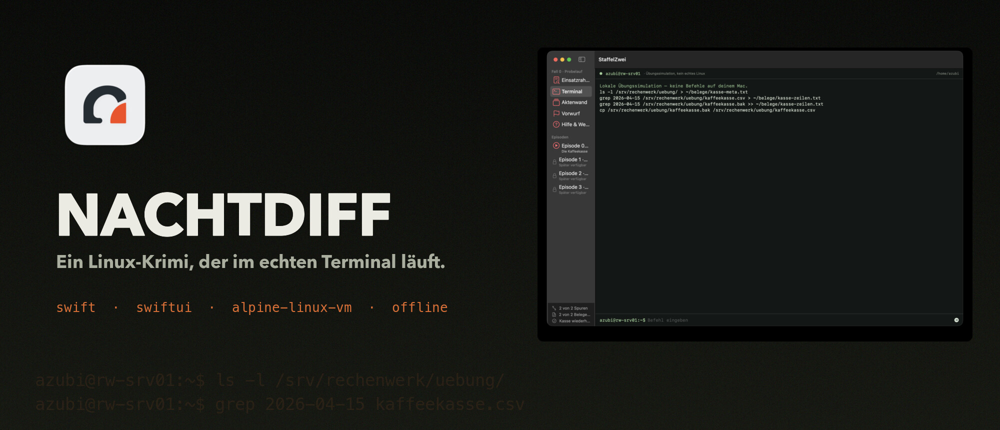
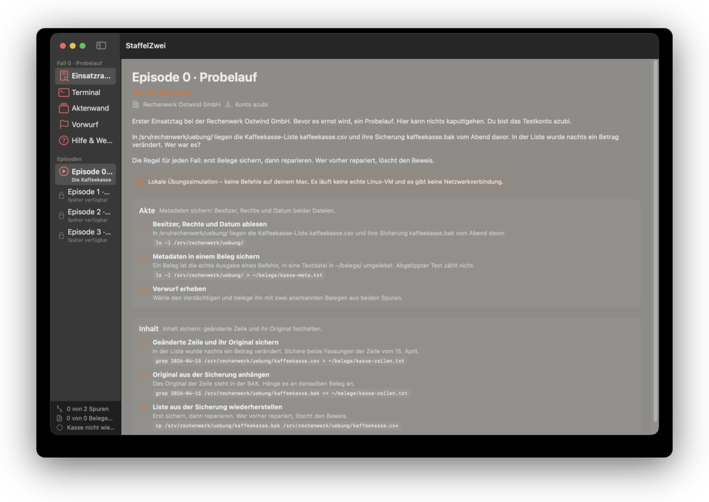
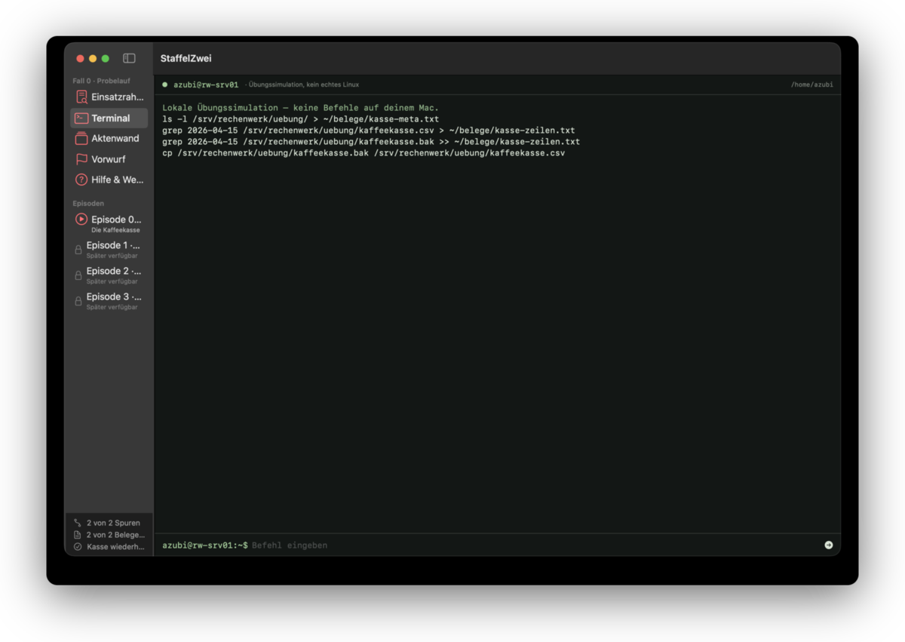
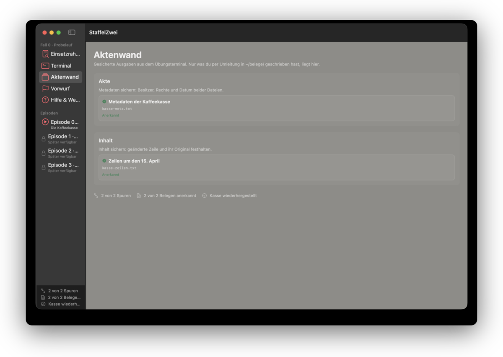
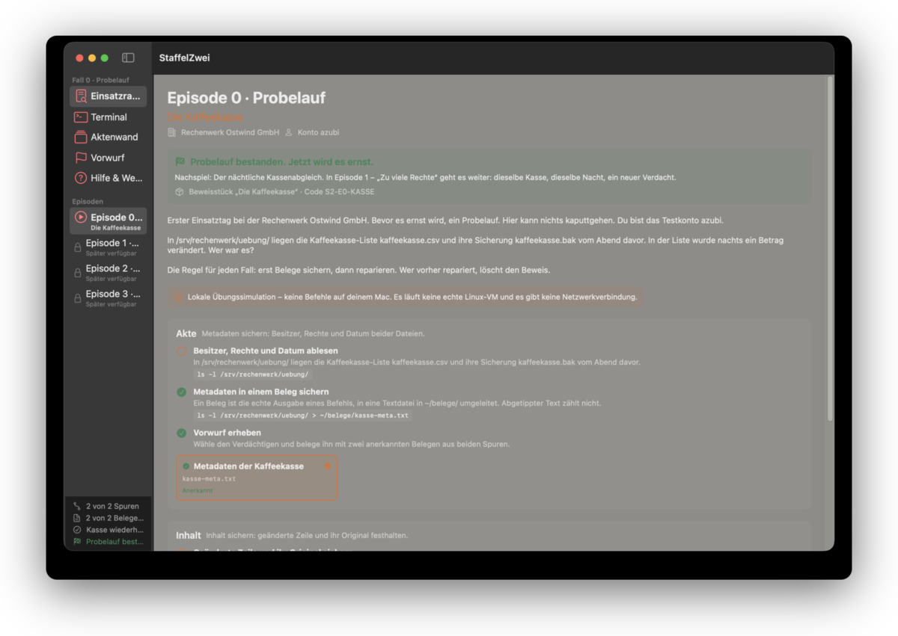
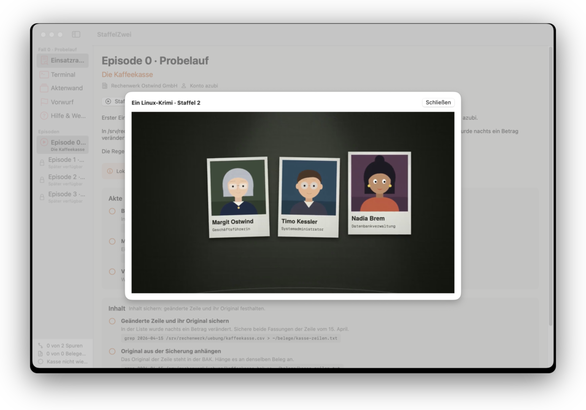
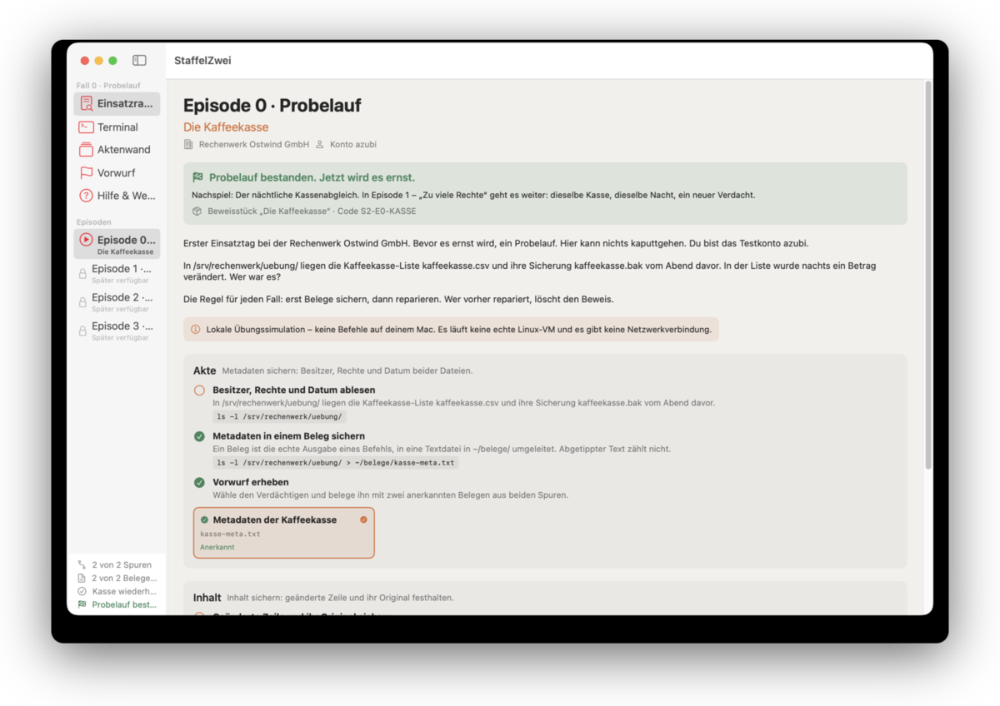
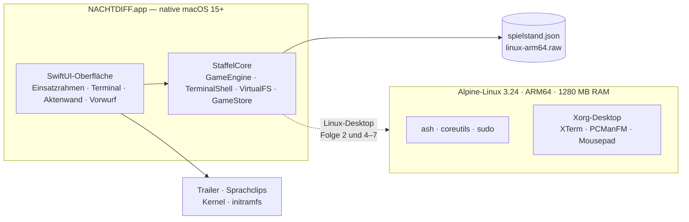

<p align="center">
  
</p>

<p align="center">
  <b>Ein Linux-Krimi, der im echten Terminal läuft.</b><br>
  <sub>SwiftUI · Alpine-Linux-VM (ARM64) · offline · macOS 15+ · Bundle-ID <code>de.alex-schneider.staffelzwei</code></sub>
</p>

<p align="center">
  <a href="https://www.swift.org"></a>
  
  
  
  
  
</p>

---

**NACHTDIFF** ist die native macOS-Fassung des Linux-Krimis
**„Staffel 2 · Rechenwerk Ostwind“**. Kein WebView, kein Server, keine Cloud:
Eine SwiftUI-App, die den Fall in einer echten Alpine-Linux-VM unter Apple
Silicon laufen lässt – im Terminal, mit `sudo`, mit Dateirechten, mit
Audit-Logs. Du arbeitest als Azubi in der Rechenwerk Ostwind GmbH, sicherst
Beweise, reparierst Manipulationen und erhebst den Vorwurf.

Der Web-Krimi läuft als Lern- und Trainingsprojekt im Browser. Diese Repo-Fassung
ist die native Umsetzung: Swift 6, SwiftUI, `Virtualization`-Framework, eine
Alpine-Linux-VM mit eigener Festplatte – ohne Netzwerkkarte und ohne
freigegebene Mac-Verzeichnisse.

| | |
|---|---|
| **Fälle** | Probelauf + sieben Folgen bis zur Übergabe im Staffelfinale |
| **Umgebung** | Alpine Linux 3.24 (aarch64), 1280 MB RAM, eigene Festplatte `linux-arm64.raw` |
| **Terminal** | Pipes, Umleitungen, `grep`, `cp`, `ls -l`, `sudo` – als `azubi` |
| **Medien** | Trailer und Sprachclips liegen im Bundle, komplett offline |
| **Netzwerk** | Keins. Die VM hat keine Netzwerkkarte. |

### Umfang

* **Probelauf und sieben Folgen** – jede Folge mit Einsatzrahmen, Aktenwand,
  Vorwurf, sprechenden Clips und einer drehbaren Serverraum-Ansicht.
* **Linux-Desktop** – ab Folge 2 (und 4–7) öffnet **Bildschirm** (Cmd-6) den
  echten Xorg-Desktop der VM mit XTerm, PCManFM, Bildbetrachter und Mousepad.
  Das Wartungsfoto liegt unter `~/fotos/IMG_0417.png`, „Stand prüfen“ aktualisiert
  die Belege nach Eingaben im grafischen Terminal.
* **Terminal-Reiter** – interaktive Bash in der Alpine-VM. Eingaben stehen direkt
  am Prompt. Tab vervollständigt Befehle und Pfade, die Pfeiltasten rufen den
  Verlauf auf und Ctrl+C unterbricht laufende Befehle.
* **Übergabe in Folge 7** – prüft vier Aussagen und den Inhalt der freigegebenen
  Datei. Nach der Abgabe sind Bericht und Schlusssequenz verfügbar.
* **Barrierearmut** – bei reduzierter Bewegung zeigt die App Standbilder und
  Dialogtext statt Bewegtbild.

---

## Screenshots

<table>
  <tr>
    <td width="50%"><br><sub><b>Einsatzrahmen</b> – Auftrag, Beweisspuren, Erfolgskontrolle</sub></td>
    <td width="50%"><br><sub><b>Terminal</b> – Befehle laufen als <code>azubi</code> in der VM</sub></td>
  </tr>
  <tr>
    <td><br><sub><b>Aktenwand</b> – Fundstücke, Protokolle, Verdächtige</sub></td>
    <td><br><sub><b>Vorwurf</b> – Verdächtiger plus zwei anerkannte Belege</sub></td>
  </tr>
  <tr>
    <td><br><sub><b>Trailer</b> – im nativen Player, mit Untertitelspur</sub></td>
    <td><br><sub><b>Hellmodus</b> – native macOS-Oberfläche, kein Web-Thema</sub></td>
  </tr>
</table>

---

## Der Bon von 03:12 Uhr

Rikes Abendabschluss und Juris Bon weichen um zwei Euro voneinander ab. Auf dem Tisch stimmt die Kasse. Woher kommt die Differenz? In `/srv/rechenwerk/uebung/` liegen die aktuelle Buchungsliste `kaffeekasse.csv` und die Sicherung `kaffeekasse.bak`.

> **Die Regel für jeden Fall:** erst Beweise sichern, dann reparieren.
> Wer vorher repariert, löscht den Beweis.

```bash
# 1. Metadaten der Listen sichern (Besitzer, Rechte, Datum)
ls -l /srv/rechenwerk/uebung/ > ~/belege/kasse-meta.txt

# 2. Geänderte Zeile und ihr Original festhalten
grep 2026-04-15 /srv/rechenwerk/uebung/kaffeekasse.csv >  ~/belege/kasse-zeilen.txt
grep 2026-04-15 /srv/rechenwerk/uebung/kaffeekasse.bak >> ~/belege/kasse-zeilen.txt

# 3. Liste aus der Sicherung wiederherstellen
cp /srv/rechenwerk/uebung/kaffeekasse.bak /srv/rechenwerk/uebung/kaffeekasse.csv
```

Danach im Vorwurf den Verdächtigen **Kaffeeautomat (Dienstkonto `kaffee`)** und
beide anerkannten Belege auswählen und „Prüfen“ auslösen.

Ein Beleg ist die echte Ausgabe eines Befehls, in eine Textdatei unter
`~/belege/` umgeleitet. Abgetippter Text zählt nicht – die App prüft, ob der
Befehl wirklich gelaufen ist.

---

## Episoden

| Folge | Fall | Thema |
|---|---|---|
| 0 · Nachtschicht | Der Bon von 03:12 Uhr | Metadaten, Belege, Reparatur, Vorwurf |
| 1 | Zu viele Rechte | Eine fremde `sudo`-Regel aus dem Betrieb nehmen |
| 2 | Der Prozess, der nicht stirbt | Ein hängender Dienst im Linux-Desktop |
| 3 | Die Lücke im Log | Was im Audit-Log fehlt |
| 4 | Der falsche Anhang | Ein manipulierter Dateianhang |
| 5 | Der letzte Export | Datenabfluss vor dem Feierabend |
| 6 | Zwei Uhren | Zeitstempel, die nicht zusammenpassen |
| 7 | Die Übergabe | Vier Aussagen prüfen und die freigegebene Datei abgeben |

Folge 4 öffnet sich nach Folge 3; danach schaltet jeder gelöste Fall die
nächste Folge frei. Die Verdächtigen: Timo Kessler, Nadia Brem,
Margit Ostwind. Micha gibt im Einsatzrahmen pro Folge einen gesprochenen
Tipp – nach einer Weile döst er und reagiert auf „Micha wecken“.

---

## Bauen

Voraussetzungen: Swift 6 (getestet mit 6.4.2), **vollständiges Xcode**, Python 3.11
oder neuer, Go und `7zz`. Der erste Build lädt die per SHA-256 fixierten
Alpine-Archive herunter.

> **Xcode ist Pflicht.** Das Terminal-Feature bringt
> [SwiftTerm](https://github.com/migueldeicaza/SwiftTerm) als Dependency mit,
> und SwiftTerm hat Metal-Shader im Source. Den Metal-Compiler gibt es nur im
> vollständigen Xcode – mit reinen Command Line Tools bricht der Build an
> `unable to spawn process 'metal'` ab. Liegt Xcode nicht im aktiven
> Developer-Verzeichnis, genügt:
>
> ```bash
> export DEVELOPER_DIR="/Pfad/zu/Xcode.app/Contents/Developer"
> ```

```bash
./build.sh              # Release-Build nach dist/NACHTDIFF.app
./build.sh --debug      # Debug-Build
./build.sh --install    # zusätzlich nach ~/Applications/NACHTDIFF.app
```

Das Skript

* baut gegen das SDK der aktiven Toolchain (`STAFFELZWEI_SDK` überschreibt es),
* legt das Bundle in einem frischen Staging-Verzeichnis unter
  `~/Library/Developer/StaffelZwei/staging` an und verschiebt es danach nach `dist/`,
* sichert ein vorhandenes `dist/NACHTDIFF.app` als `NACHTDIFF.app.bak-<Zeitstempel>`
  (nichts wird gelöscht),
* legt Kernel und Startdateisystem im App-Bundle ab und signiert
  **ad hoc** mit dem Virtualization-Entitlement,
* prüft am Ende `codesign --verify --deep --strict`.

Build-Artefakte liegen bewusst außerhalb des Repos:
`~/Library/Developer/StaffelZwei/build`.

### Starten

```bash
open dist/NACHTDIFF.app
```

Für isolierte Läufe (Tests, Screenshots) den Ablageort des Spielstands
umbiegen – die App schreibt dann ausschließlich dorthin:

```bash
open -n --env "APP_STORE=$(mktemp -d)" dist/NACHTDIFF.app
```

### Testen

```bash
./tools/test.sh
```

Der Entry-Point steckt Toolchain, SDK und Swift-Testing-Makro-Plugin selbst
zusammen und läuft mit eigenem frischem `APP_STORE`. Er findet SDK und Plugin
aus der aktiven Toolchain, setzt die Flags nur wenn nötig, gibt den Exitcode
von `swift test` unverändert zurück und wertet einen Lauf **ohne ausgeführte
Tests als Fehler**. Fehlt SDK, Metal-Compiler oder Plugin, endet er mit
Exitcode 1 und einer Diagnose – nie mit „0 Tests grün“.

Der rohe Aufruf, den das Skript intern verwendet:

```bash
swift test --scratch-path "$HOME/Library/Developer/StaffelZwei/build" \
  --sdk "$(xcrun --show-sdk-path)"
```

Der `-plugin-path` ist nur für ältere Toolchains nötig, dort wo das
Swift-Testing-Makro-Plugin nicht im Standardsuchpfad liegt. Neuere Toolchains
bringen die Makros im Compiler mit – das Skript setzt das Flag dann nicht.
Die Tests laufen ausschließlich in frisch erzeugten temporären Verzeichnissen
und berühren niemals echte Nutzerdaten.

### Prüfwerkzeuge

| Werkzeug | Zweck |
|---|---|
| `tools/test.sh` | Core-Tests reproduzierbar starten, echter Exitcode |
| `tools/app-checks.sh` | App-Pfade inklusive Negativfälle, echte Exitcodes |
| `tools/check-layout.swift` | Layout-JSONs prüfen (`--require-matrix` für die volle Screenmatrix) |
| `tools/check-layout-selftest.sh` | Negativ- und Positivtests für den Layout-Checker |
| `tools/grid-lint.sh` | Rasterregeln für `Sources` |
| `tools/windows.swift` | Fenster eines Prozesses per `--pid` auflisten |
| `tools/make-readme-assets.sh` | Banner und Galeriebilder dieser README neu erzeugen |

---

## Architektur



* **`StaffelCore`** – reine Logik ohne SwiftUI: Shell-Parser, virtuelles
  Dateisystem, Fall-Engine, Persistenz. Läuft ohne App, damit die Tests
  schnell sind und ohne Fenster.
* **`StaffelZwei`** – die SwiftUI-Oberfläche. `NavigationSplitView` mit
  Einsatzrahmen, Terminal, Aktenwand, Vorwurf und Hilfe; die Episoden liegen
  in der Sidebar.
* **Die VM** – `Virtualization`-Framework, `VZVirtualMachine` mit 1280 MB RAM,
  Kernel und `initramfs.cpio.gz` aus dem App-Bundle, eigene Festplatte
  `linux-arm64.raw`. Das Display hängt als `VZVirtualMachineView` direkt in der
  SwiftUI-Oberfläche. Das Gast-System entsteht aus Go-Binaries plus einem
  Alpine-Minirootfs (Python) zu einem eigenen initramfs.
* **Die Terminal-Simulation** – Folge 0 arbeitet bewusst in einer lokalen
  Übungssimulation: keine Befehle auf deinem Mac, keine echte VM, keine
  Netzwerkverbindung. Ab Folge 2 (und 4–7) öffnet **Bildschirm** den echten
  Linux-Desktop mit XTerm, PCManFM, Bildbetrachter und Mousepad.

---

## Daten, Sicherheit, Offline

* Die VM hat **keine Netzwerkkarte** und **keine freigegebenen
  Mac-Verzeichnisse**. `/home/azubi` und die Kassenliste liegen in der
  Linux-Festplatte, nicht auf dem Mac.
* Spielstand und VM-Festplatte liegen unter
  `~/Library/Application Support/StaffelZwei/`. `APP_STORE` überschreibt diesen
  Pfad; die weiteren Episoden haben getrennte Abbilder unter `episoden/`.
* „Fortschritt zurücksetzen“ sichert Spielstand und Festplatte der aktiven
  Episode, bevor es gelöscht wird.
* Der Probelauf arbeitet in einer Simulation. Befehle laufen dort **nicht** auf
  deinem Mac.
* Im Repo liegen keine Rohdaten: Stimmproben, Fotos und WAV/M4A/HEIC sind über
  `.gitignore` ausgeschlossen.

### Tastenkürzel

| Taste | Wirkung |
|---|---|
| Cmd-1 … Cmd-5 | Einsatzrahmen, Terminal, Aktenwand, Vorwurf, Hilfe & Werkzeuge |
| Cmd-6 | Linux-Bildschirm in Folge 2 und 4–7 |
| Cmd-Return | Vorwurf prüfen oder Übergabe abgeben |
| Cmd-, | Einstellungen |

---

## Dokumentation

| Datei | Inhalt |
|---|---|
| `docs/specs/M1.md` | M1-Spezifikation |
| `docs/specs/M1-COMPLETION.md` | Ergänzung: Abschluss-Spec mit Sicherheitsgrenzen |
| `docs/BRIEF.md` | Produkt- und Design-Brief |
| `docs/GLOSSARY.md` | einheitliche Begriffe |
| `docs/STORIES.md` | User Stories mit Abnahmekriterien |
| `docs/screens/INDEX.md` | Screen-Index der Web-Referenz |
| `docs/verification/M1-REPORT.md` | Abnahmebericht: geprüft, umgesetzt, offen |
| `docs/verification/M1-BLOCKERS-RESULT.md` | Blockerreparatur vom 18.11.2026: Änderungen, echte Exitcodes, offene Punkte |
| `docs/verification/M1-INDEPENDENT-REVIEW.md` | unabhängige Abnahme |
| `docs/readme/` | Banner und Galeriebilder dieser README (Regenerator: `tools/make-readme-assets.sh`) |

### Stand

M1 ist spielbar: **45 Core-Tests grün**, Bundle ad hoc signiert, native
Screenshots aller Seiten. Noch offen und bewusst nicht behauptet:

* echter App-Neustart mit erhaltenem Zustand (Roundtrip ist per Test belegt,
  der Neustart selbst nicht durchgeführt),
* VoiceOver-Vorlese (Accessibility-Rollen sind gesetzt, aber nicht geprüft),
* Episoden 1–3 sind sichtbar gesperrt – wie in M1 gefordert.

Die Details stehen in `docs/verification/M1-REPORT.md`.

---

## Original

Der Web-Krimi: **[linux-krimi-staffel-2](https://alex-schneider.dev/projekte/linux-krimi-staffel-2/)**
· Lern- und Trainingsprojekt zu Linux-Shell, Dateirechten, `sudo` und
Incident-Response.
