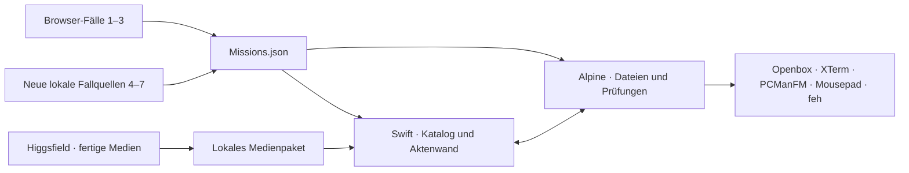

# Rechenwerk Ostwind · Fortsetzung bis zum Finale

> Umsetzungsplan · Folge 4 bis 7 · Stand 18. November 2026
>
> Spoiler für die gesamte Staffel. Diese Datei bleibt im Repository. Die App erhält nur die für den jeweiligen Spielzustand bestimmten Texte und Medien.

## Auftrag für die umsetzende KI

Erweitere die native Mac-App um vier spielbare Folgen. Setze zuerst das technische Fundament und dann immer genau eine Folge um. Beginne jede Folge mit echten Dateien und Prüfungen im Alpine-Gast. Füge dann die grafischen Arbeitsabläufe, die Aktenwand und die Auflösung hinzu. Integriere anschließend das fertige Medienpaket. Markiere eine Folge erst nach einem nachgespielten Durchlauf als fertig. Der Medienabschnitt enthält die Aufträge für Higgsfield.

Die Folgen 0–3 bilden den bisherigen Kanon. In Folge 1 spielte Timo die Regel `RW-1042` ein. In Folge 2 trug Nadia unter `RW-2122` den Wächter ein. In Folge 3 startete Nadia das Löschskript unter `RW-1051`. Diese Auflösungen bleiben gültig. Die neuen Fälle beantworten, wer den ausgehenden Wartungsexport für einen anderen Zweck nutzte, wie Nadia unter Druck geriet und wie der Betrieb sicher wieder anläuft.

## Handlung und Figuren

Der Wartungsexport sollte Messwerte für die Umstellung liefern. Timo erweiterte ihn eigenmächtig um Kundenfelder, damit sein extern vorbereiteter Testdatensatz vollständig wirkte. Er stellte den Export im lokalen Ausgang bereit und drängte Nadia, den auffälligen Fernwartungslauf zu verschleiern. Nadia startete das Löschskript und trug zwei Tage später den Wächter ein. Sie räumt beides im Finale ein. Margit ist die unabhängige Schichtleitung. Sie hat die ursprüngliche Freigabe für Messwerte erteilt, den Export zusätzlicher Felder aber ausdrücklich ausgeschlossen. Ein ausgehender Entwurf ist belegt. Ob außerhalb von Ostwind jemand Daten empfangen hat, bleibt offen.

Alex unterstützt die Beweissicherung. Micha kennt die Werkzeuge und liefert kurze Bedienhinweise. In Folge 4 döst er bei der Dateisichtung ein, in Folge 6 weckt ihn der Hinweis auf eine zweite Uhr, und bei der Übergabe bleibt er wach. Schlaf, Wecken und Dialog beeinflussen keine Freischaltung. Der Schluss hält die geklärten Verantwortlichkeiten fest und zeigt die Wiederaufnahme des freigegebenen Exports.

| Folge | Fall | Apps im Bildschirmmodus | Kernkompetenz |
|---|---|---|---|
| 4 | Der falsche Anhang | PCManFM, feh, Mousepad, XTerm | Freigabe und TSV vergleichen, Belege sichern |
| 5 | Der letzte Export | PCManFM, XTerm, Mousepad, optional lokale Tabellenansicht | Vorschau vom Ausgang unterscheiden, Kopie prüfen, isolieren |
| 6 | Zwei Uhren | Mousepad, XTerm, optional lokale Zeitleiste | Zeitzonen normalisieren, Ereignisse nach Quelle und Kennung verbinden |
| 7 | Die Übergabe | PCManFM, Mousepad, XTerm, Aktenwand und native Übergabeansicht | Befunde bewerten, sichere Wiederherstellung prüfen, Bericht abgeben |

## Folgen und Abnahme

Die folgenden Werte sind verbindliche Sollwerte für neu anzulegende Testdaten. TSV-Dateien haben Tabulatoren als Trennzeichen und LF als Zeilenende. Uhrzeiten sind ISO 8601. In den Testdaten befinden sich erfundene Konten, Änderungskennungen und Dokumente. Prüfungen verwenden die exakten Kennungen unten und tolerieren führende und nachgestellte Leerzeichen bei Texteingaben.

### Folge 4 · Der falsche Anhang

**Einstieg.** Margit bringt die Originalfreigabe. Beim grafischen Start öffnet sich PCManFM im Fallordner. Alex sagt „Sichere die Freigabe und den tatsächlich erzeugten Export. Der Dateiname sagt nichts über den Inhalt.“ Micha schläft in seinem Bürostuhl ein. Über „Micha wecken“ folgt „Öffne die Freigabe mit dem Bildbetrachter und die TSV-Datei im Editor.“

**Gastdateien** unter `~/faelle/04/`

| Pfad | Verbindlicher Inhalt |
|---|---|
| `freigabe.png` | Freigabe RW-3074, signiert Margit, „Nur Messwerte“, erlaubte Spalten `sensor_id`, `temperatur_c`, `zeit_utc`. Die Kennung und die Spalten werden groß und gut lesbar gesetzt. |
| `freigabe.txt` | Barrierefreie, gleichwertige Abschrift der Bildfreigabe |
| `entwurf.tsv` | Kopfzeile `sensor_id temperatur_c zeit_utc kunden_ref kontakt`; mindestens eine eindeutig fiktive Datenzeile |
| `aenderungen.tsv` | Kopf `kennung konto aktion`; Zeilen `RW-3074 margit freigabe_messwerte` und `RW-3074 timo exportvorlage_erweitert` |

**Spielablauf.** In feh oder der Abschrift die Freigabenummer finden. In Mousepad die TSV-Kopfzeile mit der Freigabe vergleichen. Im Terminal die Kopfzeile des Entwurfs als `~/belege/anhang-kopf.txt` und den passenden Änderungsverlauf als `~/belege/anhang-audit.txt` sichern. Drei Antworten prüfen: `freigabe-id` = `RW-3074`, `zusatzfelder` = `kunden_ref,kontakt` in beliebiger Reihenfolge und `vorlage-konto` = `timo`. Die Aktenwand muss die Rolle von Margits Freigabe getrennt von Timos Änderung zeigen.

**Abnahme.** Das bloße Öffnen des Bilds zählt nicht als Beleg. Eine richtige Kennung ohne beide Belege löst den Fall nicht. Beide Belege müssen mit den vorgegebenen Quelldaten übereinstimmen. Nach der Auflösung weist Alex auf die lokale Ausgangsablage in Folge 5 hin.

### Folge 5 · Der letzte Export

**Einstieg.** Der Export liegt zum Abholen bereit. Das Level bleibt ohne Countdown. Der Spieler hat Zeit, Verzeichnisse und Dateien zu vergleichen.

**Gastdateien** unter `~/faelle/05/`

| Pfad | Verbindlicher Inhalt |
|---|---|
| `vorschau/export-messwerte.tsv` | Nur die drei freigegebenen Spalten; Kennung `EXPORT-07-PREVIEW` in einer separaten `vorschau/info.txt` |
| `ausgang/export-07.tsv` | Dieselben Daten mit den zwei zusätzlichen Feldern aus Folge 4 |
| `ausgang/info.txt` | `paket=EXPORT-07`, `status=bereitgestellt`, `konto=timo`, `zeit=2026-04-18T00:20:00Z`, `freigabe=RW-3074` |
| `ausgang/empfang.txt` | `uebergabebeleg=offen` |
| `quarantaene/` | Leeres, vom Spielerkonto verwaltetes Verzeichnis auf demselben Gastdatenträger |

**Spielablauf.** PCManFM zeigt Vorschau und Ausgang. Der Spieler öffnet beide Kopfzeilen in Mousepad. In XTerm sichert er `ausgang/info.txt` als `~/belege/export-status.txt` und die SHA-256-Prüfsumme des Entwurfs als `~/belege/export-sha256.txt`. Das Prüffeld `export-paket` akzeptiert `EXPORT-07`. Das Prüffeld `uebergabe-status` akzeptiert `offen`. Nach der Beweissicherung verschiebt der Spieler nur `export-07.tsv` in `quarantaene/`. PCManFM und Terminal sind gleichwertige Wege.

**Abnahme.** Der Prüfer erwartet die Datei im Ziel, die Abwesenheit am ursprünglichen Pfad und den Inhalt-Hash des vorbereiteten Originals. Die Vorschau bleibt vorhanden. „Export empfangen“ ist bei `uebergabebeleg=offen` falsch. Nach Neustart des Gastes sind Belege und Quarantäne weiterhin vorhanden.

### Folge 6 · Zwei Uhren

**Einstieg.** Micha misst zwei scheinbar widersprüchliche Uhrzeiten. Alex erklärt „Vergleiche die Offsets und die Kennungen. Gleiche Minuten allein belegen keinen Zusammenhang.“ Mousepad öffnet die Legende `~/faelle/06/uhren.txt`.

**Gastdateien** unter `~/faelle/06/`

| Pfad | Verbindlicher Inhalt |
|---|---|
| `ausgang.tsv` | Header `zeit paket konto ereignis`; Zeile `2026-04-18T00:20:00Z EXPORT-07 timo bereitgestellt` |
| `journal.tsv` | Header `zeit kennung konto ereignis`; Zeilen `2026-04-18T04:21:37+02:00 RW-1051 nadia loeschlauf_gestartet` und `2026-04-20T10:47:52+02:00 RW-2122 nadia waechter_eingetragen`. Das ist eine lesbare Abschrift der vorhandenen Logereignisse in Ortszeit. |
| `schicht.txt` | Margit verließ den Raum um `2026-04-18T02:20:00+02:00`. Ihr Schichteintrag hat keine Aktion zu `EXPORT-07`. |
| `uhren.txt` | Journalwerte haben `+02:00`, der Ausgang protokolliert UTC. Erkläre das Abziehen des Offsets und die Bedeutung von `Z`. |

**Spielablauf.** Die drei Zeitzeilen aus `ausgang.tsv` und `journal.tsv` unverändert in `~/belege/zeit-originale.txt` sichern. In `~/belege/zeitfolge.txt` je Zeile UTC-Zeit, Kennung und Konto mit Tabulatoren trennen. Erwartet wird in dieser Reihenfolge `2026-04-18T00:20:00Z EXPORT-07 timo`, `2026-04-18T02:21:37Z RW-1051 nadia`, `2026-04-20T08:47:52Z RW-2122 nadia`. Eine optionale native Zeitleiste zeigt die umgerechneten Zeiten erst nach Anerkennung der Belege. Sie trägt bei jedem Punkt den Quelldateinamen.

**Abnahme.** Originale ohne Reihenfolge ergeben einen Teilerfolg. Falscher Offset, vertauschte Konten oder Margits zeitgleicher Schichteintrag als Exportbeleg führen zu einem erklärenden Hinweis. Nach korrektem Abschluss wird die angekündigte gemeinsame Übergabe geöffnet.

### Folge 7 · Die Übergabe

**Einstieg.** Alex holt Margit und Nadia zur Übergabe. Das Spiel bietet die bestätigten Erkenntnisse aus Folge 4–6 in der Aktenwand an. Der Gast erhält einen vorbereiteten Übungsdatensatz für die Funktionsprüfung, pro Fall weiterhin auf einer eigenen Platte.

**Gastdateien** unter `~/faelle/07/`

| Pfad | Verbindlicher Inhalt |
|---|---|
| `freigabe/spalten.txt` | Je eine Zeile `sensor_id`, `temperatur_c`, `zeit_utc` |
| `freigabe/messwerte.tsv` | Kopf und Beispielzeilen mit genau den drei freigegebenen Spalten |
| `betrieb/testausgang/` | Leeres Ziel für die lokale Funktionsprüfung |
| `vorlagen/uebergabe.md` | Felder für Exportverantwortung, Spurenlöschung, Empfangsnachweis und Freigabestatus |

**Spielablauf.** Mit PCManFM den freigegebenen Datensatz auswählen und als `betrieb/testausgang/messwerte.tsv` kopieren. Mit XTerm Inhalt und Spalten gegen die Vorlage prüfen und als `~/belege/finale-pruefung.txt` dokumentieren. Mousepad dient zur Sichtung der Übergabevorlage. Die native Übergabeansicht nimmt vier strukturierte Antworten entgegen: Exportvorlage und lokaler Ausgang = `timo`, Start des Löschskripts = `nadia`, externer Empfang = `unbelegt`, lokaler Testlauf = `freigegebene_messwerte`. Der Anwender ordnet die passenden Belege zu. Die App exportiert nach erfolgreicher Abgabe einen aus diesen Daten erzeugten Bericht in den Gast oder stellt ihn in der nativen Ansicht bereit.

**Finalszene.** Nadia bestätigt ihre Beteiligung am Vertuschen. Margit übernimmt die dokumentierte Übergabe. Alex sagt „Wir haben geklärt, wer den Export bereitstellte und wer die Spur löschte. Einen externen Empfang können wir nicht belegen.“ Micha antwortet „Und diesmal läuft nur, was freigegeben ist.“ Dann erscheint die Abschlusstafel mit Entscheidungen, Belegpfaden und der wiederhergestellten Funktion. Bei Wiederholung der Szene bleibt der Fortschritt unverändert.

**Abnahme.** Der Abschluss setzt bestätigte Folgen 4–6, akzeptierte Zuordnungen und einen tatsächlichen Export mit Inhalt der freigegebenen Vorlage voraus. Die Prüfung lehnt eine Kopie mit Kundenfeldern ab. Dialog, Film und Abspann werden erst nach erfolgreicher Abgabe freigegeben. Auf „Erneut ansehen“ lässt sich der Abspann erneut abspielen. Ein abgebrochener oder übersprungener Film ändert den Abschlussstatus nicht.

## Gemeinsame Umsetzung

- **Fallquellen.** Füge einen separaten, im Repo gepflegten Ordner für die neuen Episoden hinzu, etwa `tools/linux-guest/finale/`. Lege pro Folge eine Masterdatei für getrennt editierbare Spieldaten und Gastdateien an. Ergänze im vorhandenen Exporter die Zusammenführung der Browser-Fälle 1–3 mit den lokalen Folgen 4–7. Der Export sortiert nach numerischer ID und bricht bei doppelten Folgen-, Schritt- oder Beleg-IDs im jeweiligen Gültigkeitsbereich ab. Ausgabe ist weiter genau ein `Missions.json` für Swift und Go. Erstelle eine Prüfung, die nach der Zusammenführung die bisherigen drei Browser-Einträge unverändert vergleicht.
- **Bildschirmfreigabe.** Ergänze je Folge optional `desktop` mit `initialApp` und `launchers`. Fehlt das Feld, wende den bisherigen Standard für Folge 2 an. Die Prüfung `episode.id == 2` in Navigation, Kommando `bildschirm`, Modell und VM-Konfiguration durch dieselbe Fähigkeit ersetzen. Die Go-Whitelist umfasst nur bekannte Schlüssel für Terminal, Dateien, Editor und Bildbetrachter. Ein Dateiziel wird aus der jeweiligen Fallkonfiguration gelesen und muss innerhalb des vorgesehenen Gastordners liegen. Keine Befehlszeichenfolge aus der App an den Launcher durchreichen. Verwende dieselbe VM für grafische Apps, Terminalbefehle und die Dateiprüfung. Wechseln zwischen Ansichten startet den Fall nicht neu.
- **Daten und Fortschritt.** Lese beim Öffnen und bei „Stand prüfen“ die Belege erneut. Vergleiche Inhalte mit den vorbereiteten Quelldateien oder einem vorab ermittelten Hash. Korrekte Inhalte sind überprüfbar, ein abgeschriebener Inhalt mit identischen Bytes verrät seinen Erstellungsweg nicht. Markiere Rekonstruktionen als solche, wenn sie für die Handlung wichtig werden. Die Episode schreibt nur auf ihre eigene Gastplatte und aktualisiert ihren eigenen Spielfortschritt. Neue Freischaltungen leiten sich aus vorhandenen Abschlusszuständen ab. Eine bestehende abgeschlossene Folge 3 schaltet Folge 4 sofort frei.
- **Finale.** Verwende dieselbe Belegansicht und die bestehende Prüfung, wo möglich. Die neue Übergabeansicht braucht vier feste Felder und einen klaren Status pro Beleg. Ein falscher Versuch löscht nichts. Vor dem Absenden können alle Felder korrigiert werden. Verankere den Filmstart am bestätigten Ergebnis und speichere den Abschluss vor Filmstart.
- **Apps im ersten Ausbau.** XTerm, PCManFM, Mousepad, feh und Openbox sind bereits im Gast. Stelle die vorgesehenen Startdateien und Launcher pro Folge bereit. Verwende für Tabellen und Zeitleiste zunächst Mousepad oder eine schlanke native Ansicht mit Textalternative. Prüfe zusätzliche Alpine-Apps separat auf Größe, ARM64-Build und sichtbaren Mehrwert. Die interaktive Zeitleiste und ein frei drehbarer 3D-Requisitenbetrachter sind Ausbauoptionen.

## Higgsfield-Produktion und Animationen

Higgsfield dient zur Medienproduktion. Das Spiel lädt die fertigen Dateien lokal. Nutze die im verbundenen Ultra-Konto verfügbaren Funktionen gezielt über die unten beschriebenen Aufträge. Der Modellkatalog und die Kontingente sind veränderlich. Am 18. November 2026 meldete der Connector ein verfügbares Unlimited-Kontingent und nannte unter anderem GPT Image 2.6, Soul 2, Nano Banana, Seedance 2.0/2.5 und zwei Audiomodelle als Unlimited-fähige Optionen. Im abgefragten Unlimited-3D-Katalog stand kein Modell. Das ist eine Momentaufnahme des Connectors. Prüfe für die Ausführung zusätzlich die aktiven Modelle und Laufzeiten im [Higgsfield-Konto](https://higgsfield.ai/pricing) und die [offizielle Erklärung zu Unlimited](https://higgsfield.ai/creator-hub/help-center/credits/what-are-unlimited-models-and-which-plans-include-them).

### Arbeitsfolge für jeden Medienauftrag

1. Lege eine Zeile im geplanten Medienmanifest an mit Szenen-ID, Folge, Auslöser, Dauer, Dateien, Referenz, verwendeter Stimme, Ablauf bei fehlendem Medium und Qualitätsprüfung. Der Spielstand hängt nur an Spielereignissen. Jede Szene hat vom ersten Build an ein Standbild und vollständigen Dialogtext.
2. Nutze die vorhandenen Higgsfield-Alex- und Micha-Posen und den Serverraum als Figuren- und Stilreferenzen. Alex trägt den dunklen Hoodie. Micha behält die beige Jacke und den Bürostuhl. Generiere mit einem verfügbaren Bild- oder Referenzmodell eine saubere erste Frame-Komposition. Schriften, Freigabenummern, Uhrzeiten, Dateipfade und Beweise kommen aus der App oder aus lokal vorbereiteten Dateien. Sie gehören nicht in generierte Medien.
3. Verwende Image-to-Video oder Referenzvideo für kurze, ruhige Bewegungen. Wähle je Auftrag eine Kamerafahrt, eine Geste oder ein Requisiten-Insert. Für Dialogszenen verwende eine bestätigte Lip-Sync-Funktion oder Video mit Audioreferenz. Erzeuge bei Bedarf getrennte Clips für Alex und Micha. Verwende die bestehende Alex-Voice-Pipeline und für Micha das vorhandene deutsche Audio oder eine ausdrücklich für das Spiel verfügbare Stimme. Generiere Szenenton und Musik getrennt von Stimmen. Schließe mit einem lokalen Schnitt und geprüften Untertiteln ab.
4. Prüfe das Kontingent für das exakte Modell mit Format und Dauer. Verwende zuerst verfügbare Unlimited- oder freie Versuche, soweit die Route das anbietet. Abokontingent auf der Website und kostenlose Versuche im Connector getrennt prüfen. Speichere die Job-ID, warte mit dem vorgesehenen Statuswerkzeug und prüfe das fertige Ergebnis. Eine kostenpflichtige Variante braucht ein freigegebenes Budget. Bei fehlendem Zugriff auf einen 3D-Generator verwende den bestehenden RealityKit-Raum und lokale Requisiten.
5. Prüfe Kopf, Augen, Finger, Pose, Blickrichtung, Lippen, Stimme, Lesbarkeit und Lautstärke. Verwende einen sauberen Clip. Exportiere im ersten Ausbau als MP4 mit H.264/AAC, 1280 × 720, 24 oder 30 fps, separate deutsche Untertitel oder native Textzeilen. Speichere Videos unter `Resources/Einsatzszene/finale/`. Ein natives Vorschaubild bleibt bei reduzierter Bewegung und Medienfehlern verfügbar. Soundeffekte haben keinen Einfluss auf die Lösung.

### Szenenliste für die Produktion

| ID und Auslöser | Einstellung und Länge | Higgsfield-Funktionen und App-Integration |
|---|---|---|
| `ep4-briefing` · einmal beim freiwilligen Start des Briefings | 8–10 s. Alex im Servergang, ruhige Kamerafahrt, leichte Handbewegung beim Hinweis auf die Freigabe. | Referenzbild, Image-to-Video, Lip-Sync. Untertitel aus dem Einstiegsdialog der Folge. |
| `micha-doest` · im Einsatzrahmen nach dem vorhandenen Inaktivitätsintervall | 3–4 s. Kopf sinkt im Stuhl leicht zur Seite. Letzter Frame geht ins Schlafporträt über. | Image-to-Video mit Start- und Zielpose, wenn verfügbar. Keine Wiederholung des Übergangs in einer Schleife. Bei reduzierter Bewegung direkter Bildwechsel. |
| `micha-wacht` · Klick auf „Micha wecken“ | 2–4 s. Augen öffnen, kurzer Blick zum Spieler. | Referenzvideo oder Motion Control, falls enthalten. Hinweis-Audio startet nach dem Wachwechsel, bei fehlendem Clip sofort. |
| `ep5-ausgang` · Statusbeleg anerkannt | 5–7 s. Kamerafahrt am Rack, Sicht auf eine lokale Übergabestation, leises Lüftergeräusch. | Bildreferenz, Kamerasteuerung, Soundeffekt. Native Statuszeile über dem Bild. |
| `ep6-uhren` · Spieler öffnet die Uhrenlegende | 4–6 s. Zwei unterschiedliche Uhrengehäuse, direkter Schnitt ins Werkzeug. | Requisitenbild, Image-to-Video, optionaler Schnitt. Zeiten vollständig als native, zugängliche Beschriftung. |
| `ep7-uebergabe-alex` · korrekter Bericht | 8–12 s. Alex vor der Übergabestation, auf Augenhöhe, Abschlusszeile gesprochen. | Charakterreferenz und Lip-Sync. Keine Überblendung über einen Satz. |
| `ep7-uebergabe-micha` · nach Alex | 4–6 s. Micha sitzt wach, schaut zum Bildschirm und beantwortet Alex mit seinem Schlusssatz. | Sprecherclip mit eigener Audioreferenz, Blickanschluss. |
| `ep7-abspann` · nach bestätigtem Abschluss | 12–18 s. Rückfahrt aus dem Serverraum. Eine Statusleuchte wechselt langsam auf Grün, danach Titelkarte. | Cinematic Camera, Schnitt, getrennte Musik und Serverraum-Atmosphäre. Titelkarte und Credits nativ. |

Weitere im Abo aktivierte Werkzeuge bekommen einen konkreten Einsatz, sobald die Basisclips geprüft sind. Inpainting säubert Kanten an Figuren oder Requisiten. Upscaling hilft bei sichtbaren Artefakten in Nahaufnahmen. Motion Control stabilisiert wiederkehrende Gesten. Szenen- oder 3D-Werkzeuge liefern optional Rack oder Stuhl als GLB, sofern sie für das Konto verfügbar sind und als lokale Assets sinnvoll integrierbar sind. Lokale Licht- und Kameraeffekte im vorhandenen RealityKit-Raum reagieren auf den bestätigten Betriebsstatus. Für die App-Abnahme projiziert jeder Clip die erwartete Figur, läuft offline, bietet Untertitel und lässt sich stoppen. Versehentlich generierte Schrift im Bild ist ein Ablehnungsgrund.

## Umsetzungsreihenfolge

Schätzungen in Arbeitstagen. „Mit KI“ schließt menschliche Sichtprüfung und Freigabe ein. Generierungswartezeit und offene Kontofreigaben kommen bei Bedarf hinzu.

| Ticket | Arbeit und überprüfbarer Abschluss | Abhängigkeit | Handarbeit | Mit KI |
|---|---|---|---:|---:|
| F01 | Fallquellen und stabilen Export bauen. Vergleich der alten Einträge sowie Tests für doppelte IDs und fehlerhafte Daten grün. | — | 2 | 1 |
| F02 | Desktopfähigkeit und App-Auswahl verallgemeinern. Folge 2 behält ihren bisherigen Ablauf, Folge 4 startet PCManFM. | F01 | 3 | 1,5 |
| F03 | Folge 4 mit Bild, Abschrift, Dateien und Prüfungen ausliefern. Richtige und falsche Belege im echten Gast prüfen. | F02 | 2 | 1 |
| F04 | Folge 5 samt Quarantäne und Persistenz implementieren. Quarantäne über PCManFM und Terminal prüfen. | F03 | 2 | 1 |
| F05 | Folge 6 mit UTC-Auswertung umsetzen. Teilerfolg, falscher Offset und Wiederaufnahme getestet. | F04 | 2 | 1 |
| F06 | Folge 7, Übergabe und Abschluss speichern. Vorheriger Spielstand, unvollständige Belege, fehlerhafter Export und korrektes Ende geprüft. | F05 | 4 | 2 |
| F07 | Lokales Medienmanifest, verfügbare Higgsfield-Aufträge und App-Wiedergabe umsetzen. Alle acht Szenen haben geprüfte Ausgaben oder definierte lokale Ersatzmedien. | Schema nach F01, finale Auslöser nach F06 | 5–8 | 3–5 |
| F08 | Kampagnentest, GUI-Durchlauf, Signatur und Dokumentation prüfen. Start aus frischem Store und Upgrade mit Kopie eines alten Stores belegen. | F06, F07 | 2 | 1 |

Der kritische Pfad läuft über F01 bis F06 und die Abnahme. F07 kann parallel Figurenreferenzen und Rohclips vorbereiten, sobald die Szenenliste feststeht. Fertig ist die Staffel, wenn F08 einschließlich der Medienabnahme erfüllt ist.

## Prüfprotokoll für die ausführende KI

1. Arbeite auf einem eigenen Branch. Starte vor der ersten Änderung die vorhandenen Core-Tests mit `tools/test.sh`. Erweitere die Tests passend zur geänderten Fallstruktur. Prüfe pro Folge jeweils mindestens einen gültigen, fehlenden und falschen Beleg. Für Folge 7 teste zusätzlich den Widerspruch „Empfang belegt“ und den Export mit zusätzlichen Spalten.
2. Baue mit `./build.sh`. Stelle sicher, dass Gastdateien und lokale Medien im App-Bundle ankommen. Prüfe mit `codesign --verify --deep --strict dist/StaffelZwei.app`. Führe zusätzlich `tools/grid-lint.sh` aus.
3. Starte `--selftest` und `--campaign-selftest` mit jeweils eigenem, frischem `APP_STORE`. Ergänze in `SelfTest.swift` Fälle 4–7, einschließlich neuer Freischaltungen und Neustart. Für den Upgrade-Test erstelle oder verwende eine Kopie eines gültigen alten Stands mit abgeschlossener Folge 3. Der normale Spielstand ist kein Testverzeichnis.
4. Spiele Folge 2 und 4–7 im Fenster durch. Öffne jede vorgesehene grafische App mindestens einmal. Speichere in Mousepad und bestätige den Inhalt im Terminal. Prüfe das Wiederöffnen der Folge, die Bedienung per Tastatur, Texte für visuelle Belege, Untertitel, Wiedergabe ohne Netz sowie den Modus „Bewegung reduzieren“. Halte Screenshot oder Status pro Folge in der vorhandenen Verifikationsstruktur fest.
5. Logge pro Test den Folgennamen, die geprüfte Aktion und das Ergebnis. Für die Abgabe gehören Status, Buildpfad und noch ausstehende Medien in den Arbeitsbericht. Token, Kontodaten und private Quellen bleiben aus Logs und Versionskontrolle.

## Annahmen, Grenzen und Risiken

- Die vorgeschlagenen Namen, Daten und Wendungen der Folgen 4–7 sind neue Storyentscheidungen dieses Plans. Die vorhandenen Figuren und Auflösungen geben den Rahmen vor.
- Der lokale Missions-Export und die bestehende VM sind der gewählte Ausbau. Ein zweiter Desktop-Stack und eine Live-Anbindung an Higgsfield würden die Installation beziehungsweise Offline-Wiedergabe erschweren. Die App braucht keine neue Datenbank, keinen Server und keine Telemetrie.
- **Bestätigt.** Die VM lädt den Fall aus derselben Quelle wie Swift. Die bisherigen Fortschrittsdaten müssen lesbar bleiben. Alte Fälle bleiben anhand ihrer IDs erkennbar.
- **Annahme.** Der optionale Desktop-Abschnitt kann abwärtskompatibel eingeführt werden. Falls ein Zweig bereits ein entsprechendes Modell enthält, verwende dieses und dokumentiere die Zuordnung.
- **Offen.** Verfügbarkeit von Lip-Sync, 3D und konkreten Unlimited-Kontingenten bei der Umsetzung. Prüfe sie pro Medienauftrag. Der erste Durchlauf verwendet die beschriebenen lokalen Ersatzmedien, wenn ein Auftrag blockiert bleibt.
- **Leistung.** Eine aktive Gast-VM und höchstens ein abspielender Sprach- oder Videoclip gleichzeitig. Lade Clips beim Abspielen, schließe sie beim Episodenwechsel und teste auf Apple Silicon. Setze als Startbudget insgesamt 75 MB für die neuen Videos. Überschreitung zuerst durch Kürzen oder Kodierung beheben.
- **Rollback.** Einzelne Folgen und Medien als abgrenzbare Änderungen einführen. Das Entfernen eines defekten Clips darf Spielstände, Belege und Abschluss nicht verändern. Bei einem Fehler der Katalogerweiterung ist der alte Release-Build zusammen mit seiner isoliert getesteten Fortschrittsdatei die Rückfalloption.
- **Offene Kontrolle vor F01.** Vergleiche den Arbeitsbaum auf Änderungen anderer Chats, insbesondere an Medien und VM. Bearbeite nur die Dateien des jeweiligen Tickets und übernimm bereits vorhandene funktionierende Arbeit. Der aktuelle Plan schreibt keinen Branch-Zustand anderer Chats fest.

## Appendix A · Quellen im Repository

| Befund | Quelle und Beleg | Verifiziert durch |
|---|---|---|
| Das Webprojekt besitzt die bisherigen Storyvorlagen. | `../alexle135.de/src/data/staffeln/staffel-2/episode-{0,1,2,3}.ts`. Der Repository-Index lieferte für diesen Staffelpfad vier Episodendateien. | Code-Review-Graph und Quelldateien |
| Der Mac übernimmt die Browser-Fälle 1–3 per Export; Swift und Go verwenden dieselben Daten. | `tools/import-browser-missions.cjs:48` enthält `[1, 2, 3].map`; `Sources/StaffelCore/BrowserMission.swift:43` lädt `Missions.json`; `tools/linux-guest/missions.go:28` lädt den Fall für die VM. | Graph und Dateien |
| Timo spielte die Regel ein. Nadia trug den Wächter ein und startete das Löschskript. | Importierte `resolution` für ID 1, 2 und 3 in `Sources/StaffelCore/Resources/Missions.json` und `taeterId` in den Webdateien. | Datenexport und Webcode |
| Die Löschung liegt vor dem Wächtereintrag. | Die `setup`-Logs für ID 2 und 3 in `Missions.json` enthalten `2026-04-18T02:21:37Z nadia run-script change=RW-1051` und `2026-04-20T08:47:52Z nadia edit-cron change=RW-2122`. | Datenexport |
| Bildschirm und Bildschirmbefehl sind derzeit auf Episode 2 begrenzt. | `Sources/StaffelZwei/AppModel.swift:97,147,235`; `Sources/StaffelZwei/LinuxGuest.swift:136` konfiguriert die VM-Grafik. | Graph und Dateien |
| Programme starten im selben Gast als `azubi`. Die Desktop-Aktionen stammen aus einer festen Liste. | `tools/linux-guest/missions.go:129` bis zur Funktion `addEvidence`; `tools/linux-guest/desktop/session.sh`. | Graph und Dateien |
| Der Kampagnentest verwendet einen Teststore. | `Sources/StaffelZwei/SelfTest.swift:60,211`; `README.md` beschreibt die separaten Abbilder unter `episoden/`. | Graph und Dateien |
| Higgsfield deckt Medienarten und Bezugswege unterschiedlich ab. | Connector `balance` und `models_list` für Bild, Video, Audio und 3D am 18. November 2026; offizielle Erklärung zu Unlimited im Produktionsabschnitt. | Connector und Herstellerdokumentation |

## Context Handoff (for downstream skills)

- **Repositories.** `linux-mac` ist das Umsetzungsrepo. `alexle135.de` liefert die bestehende Browser-Vorlage. Beide waren im Code-Review-Graph registriert.
- **Analogien.** `tools/import-browser-missions.cjs` für den Export, `BrowserMission.swift` für das Decoding, `missions.go` für Gast-Setup und Nachweise, `LinuxDesktopView.swift` und `AppModel.swift` für die Werkzeuge, `Einsatzszene.swift` für Szenen und Stimmen, `SelfTest.swift` für die Testführung.
- **Grenzen.** Implementiere eine Folge pro Ticket und teste mit einem frischen Store. Lokale Dateien und Spielereignisse bestimmen den Fortschritt. Higgsfield-Medien werden vorab erzeugt und offline eingebunden.
- **Erster Auftrag.** F01 beginnen. Vor dem Schreiben den aktuellen Arbeitsbaum prüfen, die Importquelle und Ausgabe lokalisieren und einen reproduzierbaren Vergleich von Folge 1–3 vor und nach der Erweiterung erstellen.
